# kotor2-rs

A from-scratch Rust reimplementation of the engine for Star Wars: Knights of
the Old Republic II - The Sith Lords. It reads models, textures, maps and
sounds from your own installed copy of the game at runtime. This repository
contains no game files.

Status: playable from New Game (character creation, Ebon Hawk prologue,
Peragus onward) on the Aspyr Linux build, with known gaps below.

## Screenshots

Captured from kotor2-rs running on the Aspyr Linux data (`--screenshot`
runs, 1067x800).

<a href="docs/screenshots/01-main-menu.jpg">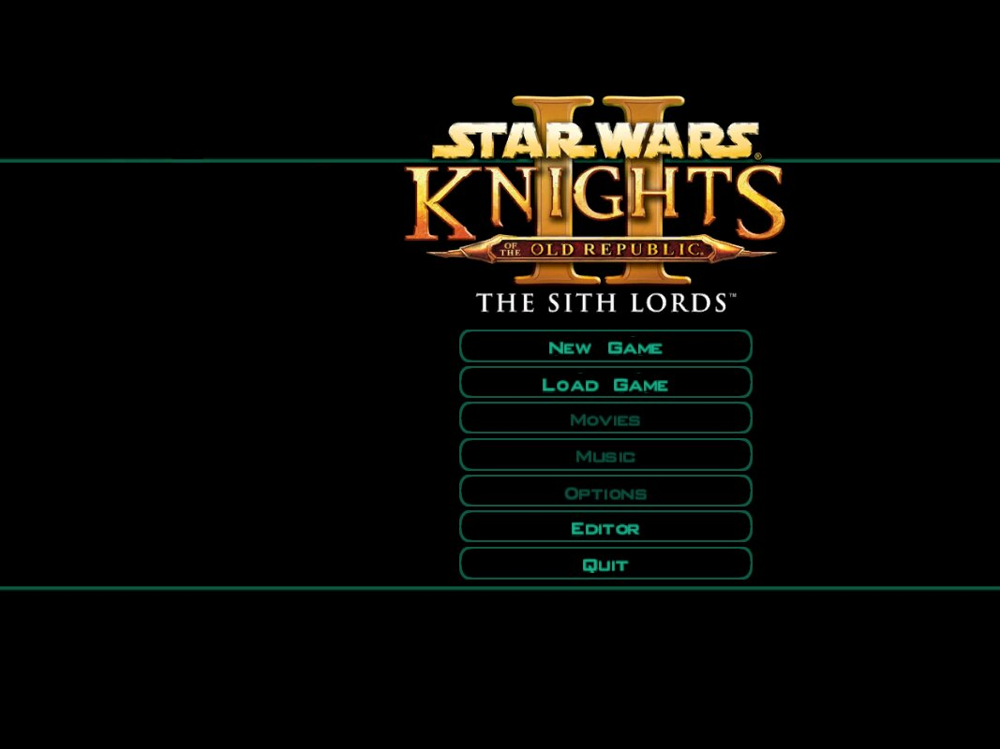</a> <a href="docs/screenshots/02-chargen.jpg">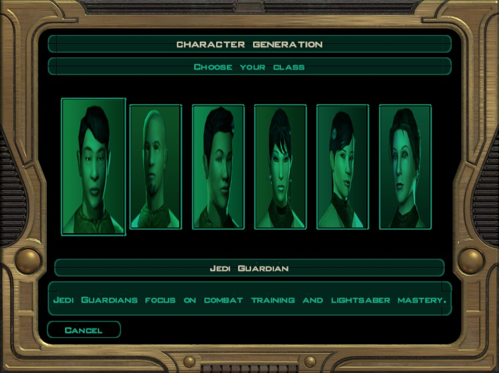</a> <a href="docs/screenshots/03-peragus-medbay.jpg">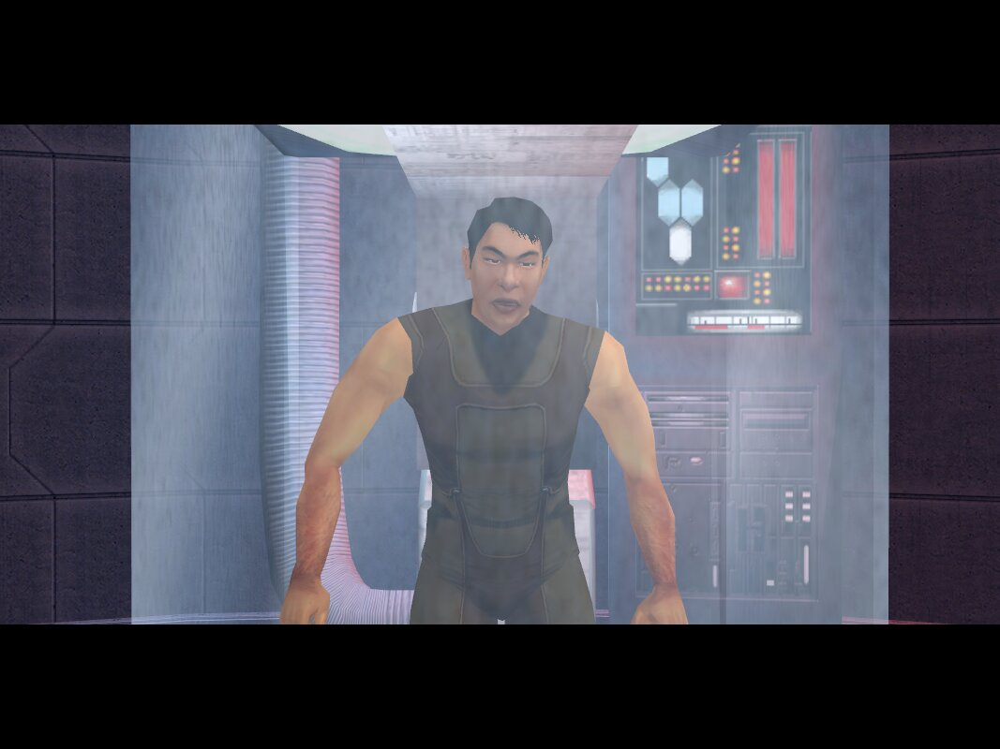</a>

<a href="docs/screenshots/04-telos.jpg">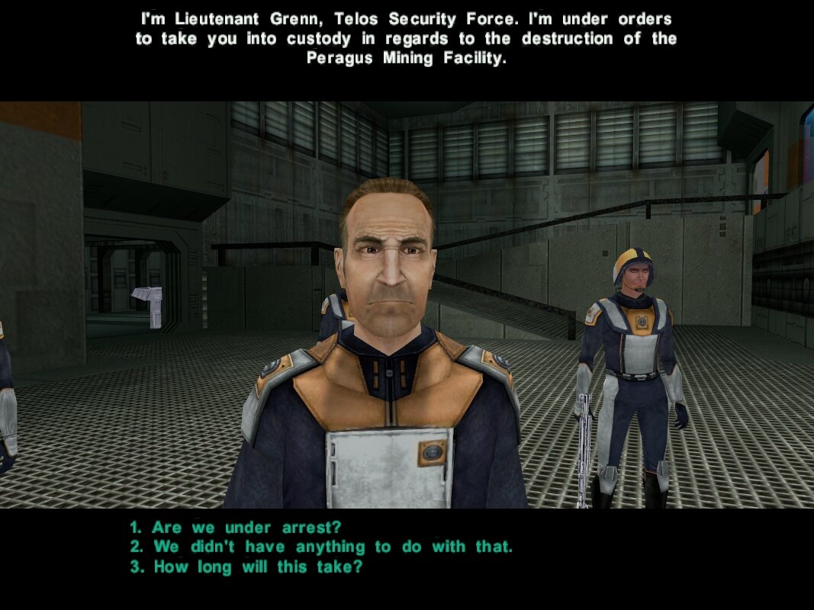</a> <a href="docs/screenshots/05-dxun.jpg">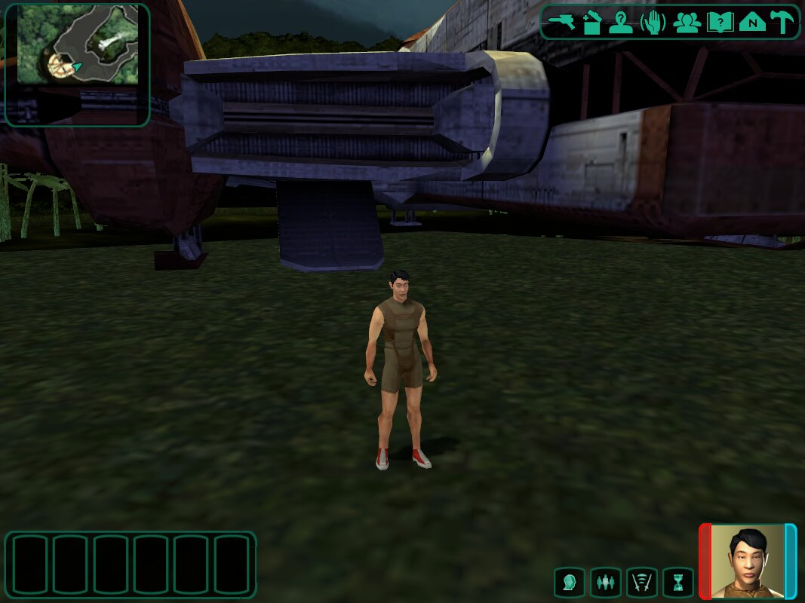</a> <a href="docs/screenshots/06-onderon.jpg">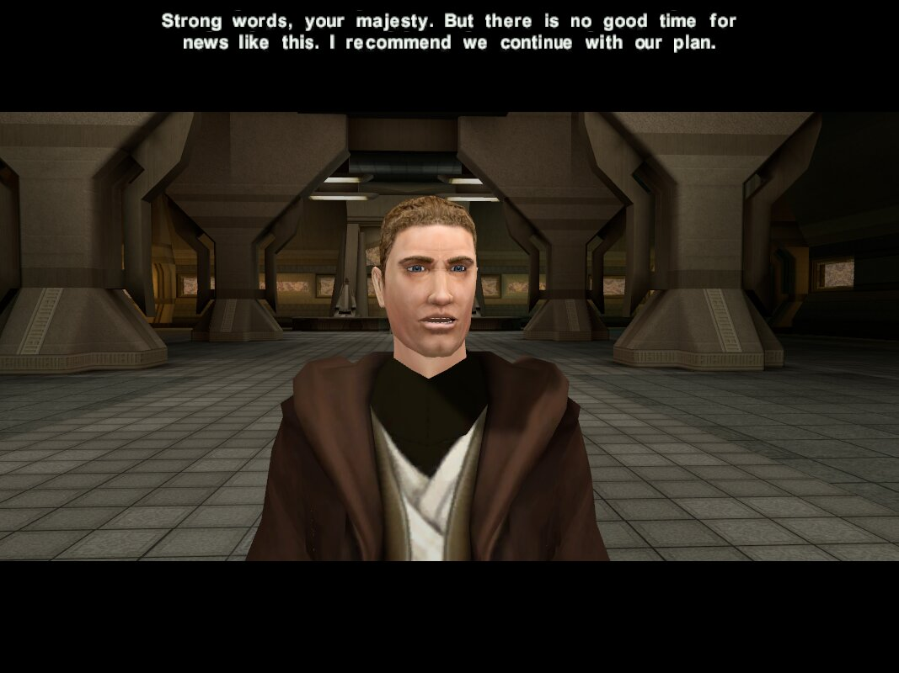</a>

<a href="docs/screenshots/07-dantooine.jpg">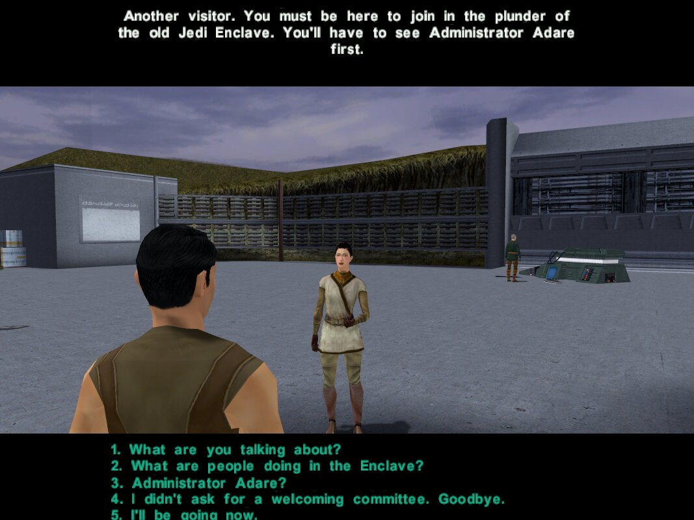</a> <a href="docs/screenshots/08-korriban.jpg">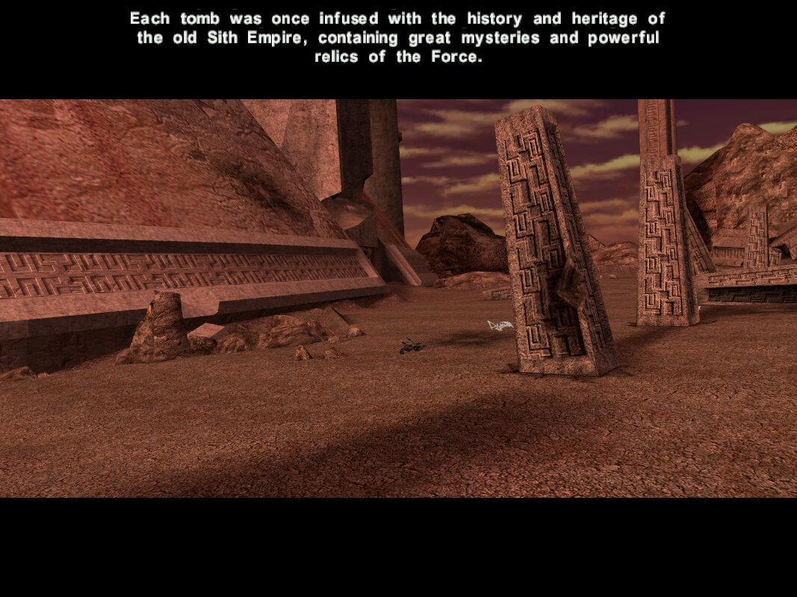</a> <a href="docs/screenshots/09-inventory.jpg">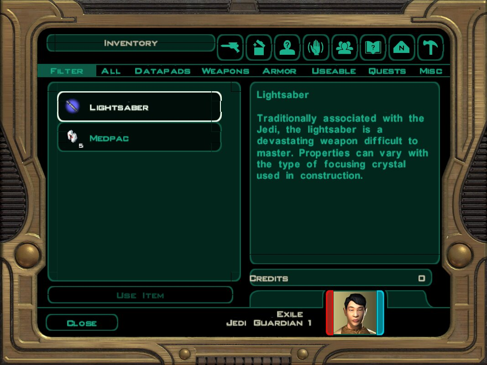</a>

<a href="docs/screenshots/10-swoop-race.jpg">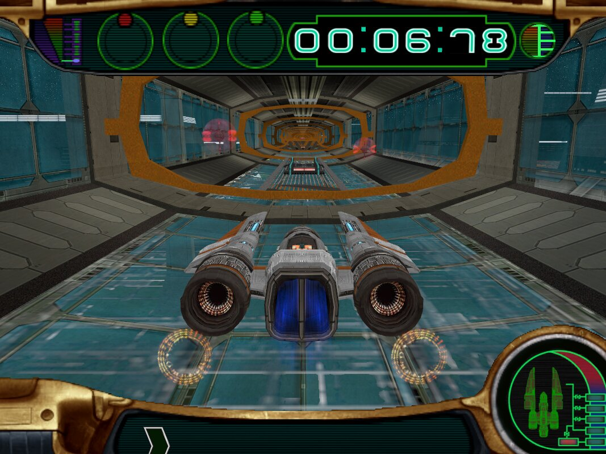</a> <a href="docs/screenshots/11-turret.jpg">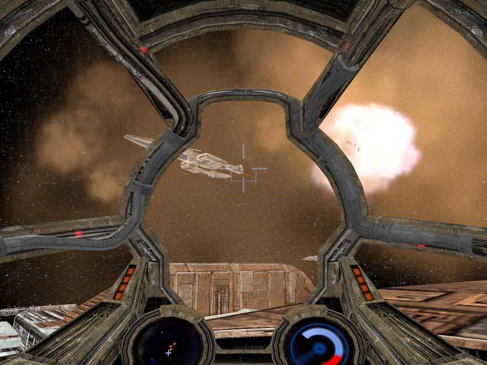</a>

## What works

- Rendering of every area: K2 models (3237/3237 parse), textures, lightmaps,
  skinned and animated creatures, holograms, lip sync, Bink movies (ffmpeg).
- The game's own scripts: an NCS VM with the K2 routine table built from your
  install; all 3732 shipped scripts run without VM errors.
- World simulation: objects, globals, action queues, events, dialog with
  conditions and facing, area transitions, pathfinding, crowd collision.
- Combat with the game's AI scripts, Force powers and talents, XP and level
  up, party management and leader switching, mines, traps, stealth,
  influence and alignment.
- The original GUI from .gui layouts: main menu, character creation, HUD,
  inventory, equipment, loot, stores, character sheet, abilities, journal,
  messages, map, party selection, level up, workbench and lab station.
- Minigames: turrets, swoop racing, pazaak.
- Audio: music, ambience, sound objects, voice, combat and GUI sounds.
- Save/load with module memory; an in-engine area editor that writes mods.

## What is missing or approximate

- Crafting costs, kill XP and spell DCs use approximated formulas.
- Swoop upgrades, trapped doors/containers, some scripted camera angles.
- No full playthrough has been verified past the opening modules.

## Building

Requires Rust (see `rust-toolchain.toml`).

    cargo build --release
    target/release/k2probe --install "/path/to/Knights of the Old Republic II" info

`--install` (or `K2_INSTALL`) defaults to `..`, i.e. the repo checked out
inside the game folder.

## Credits

- rakata (https://codeberg.org/Synchro/rakata, GPL-2.0-or-later): file format
  readers used as a dependency; the binary MDL reader is vendored in
  `crates/k2-mdl` and extended for KotOR2.
- kotorblender (https://github.com/OpenKotOR/kotorblender), PyKotor
  (https://github.com/OpenKotOR/PyKotor), reone
  (https://github.com/seedhartha/reone), xoreos (https://xoreos.org) and the
  BioWare Aurora format documents: format and engine knowledge.

Star Wars: Knights of the Old Republic II is owned by Lucasfilm/Disney,
developed by Obsidian Entertainment, ported by Aspyr. This project is not
affiliated with them. You need to own the game to use it.

## Contributing

Contributions of any kind are welcome, from anyone: hand-written patches,
AI-assisted work, and vibe-coded pull requests alike. Same bar for all of
them -- if it builds, passes the tests, and matches how the code already
behaves, it is good enough. See `AGENTS.md` for the layout and rules before
you start.

## License

GPL-2.0-or-later. See `LICENSE`.
